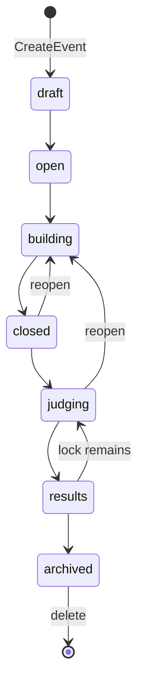
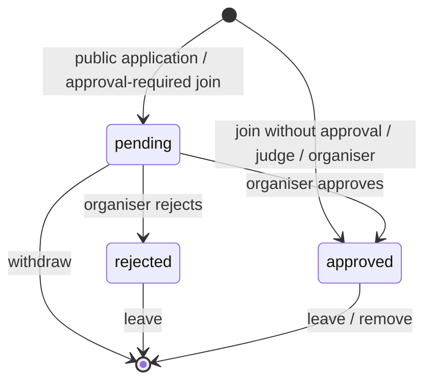
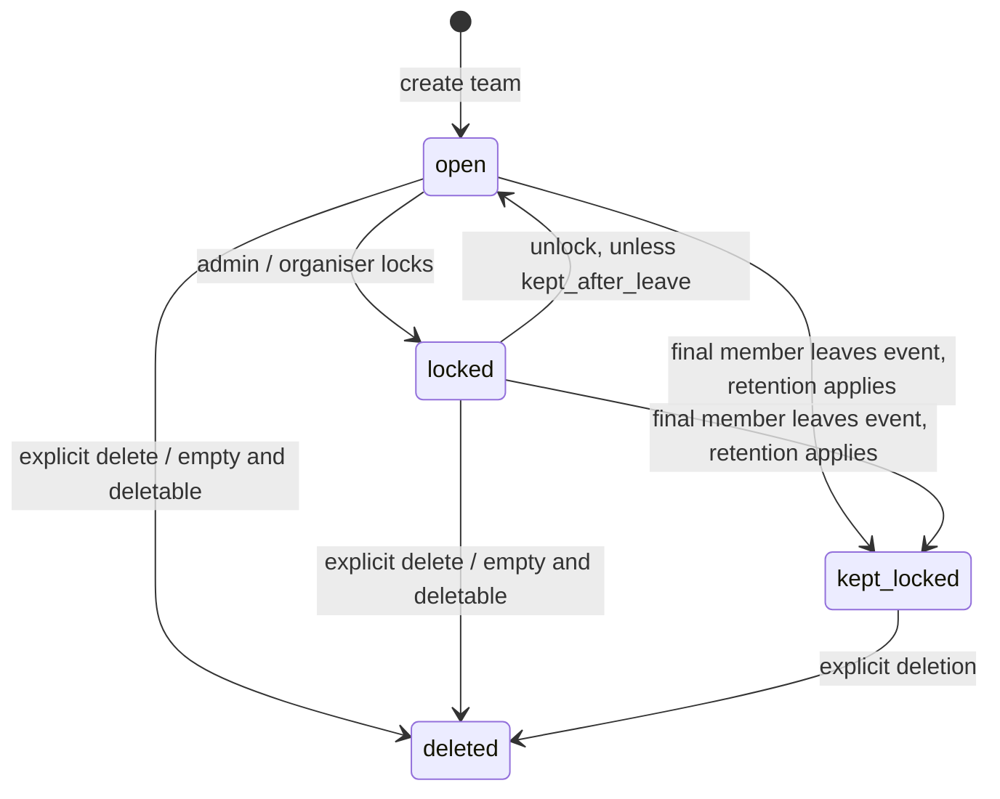
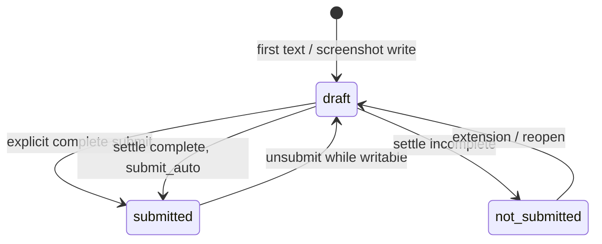
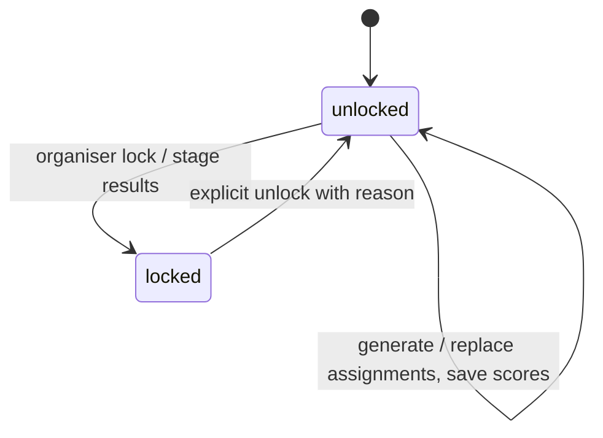
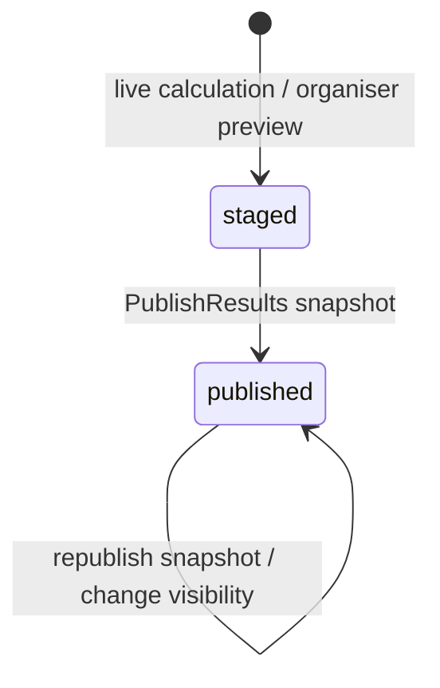

# Simple Hack domain and state

This is the implementation map. For the organiser and agent workflow, see
[the event lifecycle](../hack-event-lifecycle.md). For package direction, see
[the architecture map](../../ARCHITECTURE.md) and [the target](target.md).
Storage publication and delivery consistency are covered in [persistence](persistence.md);
screens and bundles are covered in [frontend](frontend.md).

Source references below give a path and function/type name, relative to the repository root.
They describe the current implementation, including checks still owned by transport.

## Records and ownership

Shared records have no SQL or HTTP dependencies. Repositories execute SQL over
`repository/sqlkit.Querier`; application services open workflow transactions.
HTTP decodes and authenticates, calls a service, then builds the response.
Some response construction still runs inside a service transaction via a callback
(`app/hack/entries/results.go`, `PublishResults`).

| Record | Shared type and storage | Repository and application owner |
|---|---|---|
| Event | `model/hackevents.go`, `Event`; `events` | `repository/hackevents/events.go`; `app/hack/events/create.go` (`CreateEvent`, `SetStage`, `PatchEvent`, `DeleteEvent`) |
| Member | `model/hackevents.go`, `EventMember`, `EventPerson`; `event_members` | `repository/hackevents/registration.go`, `membership_queries.go`, `leave.go`; `app/hack/members` and `app/hack/events/join.go` |
| Application | `model/hackevents.go`, `RegistrationApplication`, `ApplicantProfile`; approval/profile fields on membership | `repository/hackevents/registration.go`; `app/hack/members/apply.go`, `registration.go` |
| Team | `model/hackevents.go`, `EventTeam`, `TeamRequest`; `event_teams`, `event_team_requests` | `repository/hackteams`; `app/hack/teams` |
| Entry | `model/hackentries.go`, `EventEntry`; `event_entries` | `repository/hackentries/entries.go`; `app/hack/entries/entry.go`, `settle.go`, `rules.go` |
| Track | `model/hackentries.go`, `EventTrack`; `event_tracks`, team's `track_id` | `repository/hackevents/registration.go`; `app/hack/members/registration.go` |
| Rubric | `model/hackjudging.go`, `RubricCriterion`; `rubric_criteria` | `repository/hackentries/judging.go`; `app/hack/entries/rubric.go` |
| Assignment | `model/hackjudging.go`, `JudgeAssignment`; `event_assignments`, `event_track_panels` | `repository/hackentries/options.go`; `app/hack/entries/assignments.go` |
| Score / conflict | `model/hackjudging.go`, `RawScoreRow`; repository `JudgeScore`, `EventConflict`; `event_scores`, `event_conflicts` | `repository/hackentries/judging.go`, `options.go`; `app/hack/entries/scores.go`, `conflicts.go` |
| Departed judge | `model/hackevents.go`, `FormerJudge`; `event_former_judges` | `repository/hackevents/leave.go`; `app/hack/members/leave.go`, `app/hack/entries/judging_tx.go` |
| Vote | `model/hack_misc.go`, `VotingSettings`, `VoteOption`; `event_votes`, settings on event | `repository/hackentries/voting.go`; `app/hack/entries/voting.go` |
| Results | `repository/hackentries/judging.go`, `EventResultsRow`; `event_results` snapshot | `app/hack/entries/results.go`; pure `rules/hackentries/scoring.go` |
| Content / announcement | `model/hack_misc.go`, `EventContent`, `EventAnnouncement`; `event_content`, `event_announcements` | `repository/hackevents/content.go`, `announcements.go`; `app/hack/events/content.go` |
| Notices / mail | `model/hack_misc.go`, `Notice`, `MailNotice`, `MailBatch`, `EventMail`; `event_notices`, `event_announcement_deliveries`, `event_entry_receipts`, `event_entry_reminders` | `repository/hackevents/notice_delivery.go`, `announcements.go`; `app/hack/events/notices.go`, `content.go`, `reminders.go` |
| Team site / credential | `model/hack_team_state.go`, `TeamIdentity`, `TeamWriteState`, `TeamKeyInfo`; `sites`, `event_team_keys`, `api_keys` | `repository/hackteams/team_sites.go`, `team_keys.go`; `app/hack/teams/keys.go` plus shared site/account services |

Paths in this table are under `internal/`. Schema constraints and cascade relationships
are in `db/schema.sql`; these records are not separate databases.

The domain rules live in `internal/rules/hackevents` (registration, applications,
stage classification, leave cases, schedule), `hackteams` (participant team stages,
slug construction), and `hackentries` (completeness, judgeability, rubric validation,
assignment planning and score arithmetic). Rules receive values; services and repositories
supply the clock, records and side effects.

The transport entry points are `internal/hackhttp/hack.go` (`Register`, `loadMember`),
`hack_entries.go`, `hack_judging.go`, `hack_registration.go`, `hack_teams*.go` and
`hack_voting.go`. MCP registers event and entry families in
`internal/mcp/families_hack.go` (`hackFamilies`); `hack_event_tools.go` and
`hack_entry_tools.go` map tools to the same REST operations. Do not implement a
second permission or eligibility engine in MCP.

## Event stage

The arrows show the normal sequence and useful return paths, not an adjacency
constraint. `hackhttp/hack.go` (`hackStagesOffered`, `setStage`) accepts any offered
stage; `app/hack/events/create.go` (`SetStage`) makes `archived` irreversible.
Ending requires participants; an unused event must be deleted instead.
Deletion is a separate operation and can occur at any stage (`DeleteEvent`).

`SetStage` locks the event, then all its team rows. In the same transaction it:

- Brings the event deadline forward to now when first closing submissions, unless
  it has already passed; later team extensions survive.
- Clears passed event/team deadlines when returning to `open` or `building` from
  another stage, and reopens unsubmitted settled drafts.
- Clears pins that no longer apply (`repository/hackteams/team_sites.go`, `UnpinReopened`).
- Settles frozen entries on moves to `closed`, `judging` or `results`.
- Sets the judging lock on entry to `results`. Returning to `judging` retains it.

See `app/hack/events/create.go`, `SetStage` and `ArchiveEventTx`, and
`repository/hackevents/stage_queries.go`. A stage change does not itself publish
results; publishing writes a separate snapshot.

## Membership and applications

A member has one role in an event: `organiser`, `participant` or `judge`.
Team admin is a membership flag, not a fourth role. A participant's approval
status is distinct from the role and from team membership
(`model/hackevents.go`, `EventMember`, `EventPerson`).

`app/hack/events/join.go`, `JoinByCode`, admits participants only in `open` or
`building`; judge links work until `results` or `archived`. A person already in
the event cannot acquire a different role through a second join link.
`app/hack/members/apply.go`, `Apply`, creates a pending participant application.
Public applications require listing, the applications switch, and stage `open`
or `building` (`rules/hackevents/applications.go`, `ApplicationsOpenNow`).

`app/hack/members/registration.go`, `DecideApplication`, only decides pending
applications, locks the event, and writes the decision notice in that transaction.
`SetRegistration` can admit pending join-link registrations when approval is turned
off; public applications still wait for a decision. Withdrawal deletes the membership
row, so applying later starts again (`app/hack/members/leave.go`, `Leave`).

## Teams: admission lock versus submission freeze

Here `open` means no `locked_at`; it is not the event stage. `EventTeam.Locked()`
checks that timestamp. `repository/hackteams/admin.go`, `SetTeamLock`, clears pending
requests and invites when locking. An ordinary lock blocks code/link/request joining;
organiser placement is separate. `kept_after_leave` prevents unlocking or replacing
members even through organiser placement (`repository/hackteams/teams.go`,
`MoveParticipantToTeam`; `admin.go`, `SetTeamLock`).

A submission freeze is computed separately by `model/hack_team_state.go`,
`TeamWriteState.Frozen`: stage `judging`, `results` or `archived`, or a reached
effective deadline. Locking admission alone does not freeze an entry or site.
The `closed` stage alone does not override a future team extension: closing sets
the event deadline, while `judging` freezes every team regardless of extensions.
Participant team changes are limited to `open` and `building`
(`rules/hackteams/stages.go`, `ParticipantTeamStages`).

Admin mutations re-read authority under locks (`app/hack/teams/admin.go`,
`participantTeam`, `ParticipantAdmin`, `ParticipantLock`, `ParticipantLink`).
The last admin cannot be demoted; a departure promotes the longest-standing
remaining member when necessary (`repository/hackteams/admin.go`, `SetTeamAdmin`,
`EnsureTeamAdmin`). For these team workflows, the lock helpers use event, member,
then team ordering; two named members are sorted by user ID
(`app/hack/teams/locks.go`, `LockCallerAndTargetTeam`).

## Entries and settling

`unsubmit` is an operation returning to draft, not a stored status.
`excluded_at` is an independent flag over any entry status:
`included -> excluded -> included`, controlled by organisers. Exclusion preserves
the entry and scores but removes judging eligibility (`app/hack/entries/entry.go`,
`SetExcluded`). `model/hackentries.go`, `EventEntry.Status`, derives the visible
status from `submitted_at` and `submit_settled_at`.

`app/hack/entries/entry.go`, `Write`, locks membership and team before applying
text, screenshot, submit or unsubmit changes. It checks `TeamWriteState.WriteRefusal`
and optional `updated_at` concurrency stamps. A submitted entry can be edited only
if the result remains complete (`keepComplete`); otherwise the transaction rolls back.
Completeness is `rules/hackentries/entries.go`, `Evaluate`, using expanded event
rules, current site availability and track requirements.

Effective deadline is the SQL expression in `repository/hackevents/leave.go`,
`EffectiveDeadlineSQL`: no event deadline means no effective deadline; otherwise
use `GREATEST(event submission_deadline, team deadline_override)`. A team override
extends the event deadline; it cannot shorten it or create a standalone deadline.
`repository/hackteams/team_sites.go`, `TeamWriteStateFor`, supplies database
`clock_timestamp()` rather than transaction-start time.

`app/hack/entries/settle.go`, `SettleTeamTx`, decides an unsettled frozen draft:
a complete draft gets an automatic submission timestamp at the effective deadline
(or now without one); an incomplete draft gets `submit_settled_at` without
`submitted_at`. Both qualify for judging unless excluded. Already submitted or
settled entries are left alone. The row means the decision was made, not that it
passed validation. `SettleEventTx` also creates an empty entry for a frozen team
with a live site but no entry form; a team with neither stays out.

`SettleDue` sweeps candidates, with one transaction per team (`SettleTeam`).
Stage moves call `SettleEventTx` inside their existing transaction.
Extensions and later deadlines clear settled unsubmitted drafts so they can be
reconsidered (`app/hack/teams/keys.go`, `SetDeadline`;
`app/hack/events/create.go`, `PatchEvent`).

## Judging and results

Assignment mode is independent of the judging lock: `open` permits every eligible
judge/team pair, `automatic` and `manual` require assignment rows, and `panel`
requires a judge on the team's track panel. Conflicts remove pairs in every mode
(`repository/hackentries/options.go`, `EligibleJudgeTeams`). Generating assignments
uses pure `rules/hackentries/assignments.go`; writes and validation belong to
`app/hack/entries/assignments.go`, including `optionsTx`'s fresh lock check.

Scores are criterion rows, with a judge comment repeated across that judge's team
scores. `app/hack/entries/scores.go`, `PutJudgeScores`, locks the event, checks the
judging lock, scoring stage, current judge/organiser membership, criterion bounds
and pair eligibility, then commits scores together. Normal scoring stages are
`closed` and `judging`; the standing demo has a deliberate exception
(`hackhttp/hack_judging.go`, `scoringStage`). Declaring a conflict leaves scores
stored; eligibility excludes them from totals and comments until it is removed.

“Staged” here is a conceptual preview, not a stored database state.
`app/hack/entries/results.go`, `ComputeResults`, reads rubric, teams, scores,
eligibility and tracks, then calls pure `rules/hackentries/scoring.go`.
`PublishResults` locks the event, recomputes, applies validated rank overrides,
builds cards through a transport callback, and upserts `event_results` in one
transaction. There is no stage/lock prerequisite in that service or its HTTP
publish handler; the screen's forward workflow is not an extra server constraint.
`repository/hackentries/judging.go`, `UpsertEventResults`, preserves `full_ranking`
on republish. Public reads filter rank/score visibility and refresh site links
against current live sites (`hackhttp/hack_judging.go`, `getPublicResults`,
`liveResultSites`); they do not recalculate the stored ranks.

## Actor and operation checks

`O` = organiser; `P` = approved participant; `A` = team admin (also P);
`J` = judge; public means no event membership. “Own” limits the operation to the
actor's team or score. Every cell also obeys the operation's stage/deadline checks.

| Operation | O | P | A | J | Public | Permission check (under `internal/`) |
|---|---|---|---|---|---|---|
| Event settings, stages, registration decisions, announcements | yes | — | — | — | — | `hackhttp/hack.go`, `setStage`; `hack_registration.go`; `hack_content.go`: `loadMember(..., "organiser")` |
| Apply / join by shared code | existing role unchanged | existing role unchanged | same | same | signed-in applicant | `app/hack/members/apply.go`, `Apply`; `app/hack/events/join.go`, `JoinByCode` |
| Create/join/leave team | — | own | own | — | — | `hackhttp/hack_teams.go`; `app/hack/teams/membership.go`, `JoinTeam`, `LeaveTeam` |
| Rename, lock, rotate link, manage admins | any team | — | own | — | — | `hackhttp/hack_teams_admin.go`; `app/hack/teams/admin.go`, `participantTeam` |
| Request to join | — | self, no team | — | — | — | `repository/hackteams/fill.go`, `NewTeamRequest` |
| Withdraw join request | — | requester only | requester only | — | — | `repository/hackteams/fill.go`, `ResolveTeamRequest` |
| Accept/decline join request | — | — | own team | — | — | `repository/hackteams/fill.go`, `ResolveTeamRequest`: team admin, no organiser override |
| Send/cancel invitation | — | own team | own team | — | — | `repository/hackteams/fill.go`, `NewTeamRequest`, `ResolveTeamRequest`: any approved teammate |
| Accept/decline invitation | — | invitee only | invitee only | — | — | `repository/hackteams/fill.go`, `ResolveTeamRequest`: invitee; acceptance also checks joining eligibility |
| Place/remove people; delete team | yes | — | own member removal | — | — | `hackhttp/hack_teams.go`, `hack_finding.go`; `app/hack/teams/organiser.go`, `RemoveTeamMember` |
| Edit/submit/unsubmit entry, screenshot | — | own | own | — | — | `hackhttp/hack_entries.go`, `entryWrite`; `app/hack/entries/entry.go`, `Write` |
| Exclude/include entry, rubric/assignments/lock/publish | yes | — | — | — | — | `hackhttp/hack_entries.go`, `setEntryExcluded`; `hack_judging.go`: organiser role gate |
| Queue and scores | own judging | — | — | own judging | — | `hackhttp/hack_judging.go`, `judgeQueue`, `putJudgeScores`; `app/hack/entries/scores.go`, `PutJudgeScores` |
| Declare conflict | any judge | — | — | self | — | `hackhttp/hack_judging.go`, `declareConflict` |
| Vote | eligible | eligible, not own team | same | eligible | signed-in eligible voter | `app/hack/entries/voting.go`, `CastVote`; `hackhttp/hack_voting.go` |
| Public gallery / published results | yes | yes | yes | yes | yes | `hackhttp/hack_public.go`; `hack_judging.go`, `getPublicResults` |
| Leave event | self | self | self | self | — | `app/hack/members/leave.go`, `Leave`; custom membership gate in `hackhttp/hack_leave.go` |

`hackhttp/hack.go`, `loadMember`, rejects non-approved participants on writes and
role-specific reads, rejects taken-down-event writes, and hides wrong roles as
not-found. A platform admin without membership gets read-only organiser access;
that does not grant participant writes or judging identity. Request/invitation
operations also require team finding enabled and an `open` or `building` stage
(`hackhttp/hack_finding.go`, `findingAccess`).

## Holding account, departures and side effects

`app/hack/events/create.go`, `CreateEvent`, creates an event holding account and
organiser membership in one transaction. Team sites belong to that account,
with the team slug as site name. `repository/hackteams/team_sites.go`,
`ResolveTeamIdentity`, resolves a credential to the current approved participant,
team, one site name and holding account; `RevokeStaleTeamKeys` deletes obsolete keys.
Deadline pins capture the active site version after any already-admitted deploy
finishes (`PinDueTeams`, `pinTeam`); filesystem work is outside that pin transaction.

`app/hack/members/leave.go`, `Leave`, locks the event and commits membership removal,
creator handover or last-organiser closure, former-judge bookkeeping and key
revocation together. Empty-team deletion uses `TeamKeepableSQL`, not submission
freeze: it deletes an unpinned team whose effective deadline is absent or future
(`repository/hackevents/leave.go`, `TeamKeepableSQL`;
`repository/hackteams/teams.go`, `DeleteTeamIfEmpty`). Otherwise self-leave retains
the empty team and marks it `kept_after_leave`, locked forever (`LeaveMembership`,
`MarkTeamKeptAfterLeave`). A team in Judging with a future extension is frozen
but can still be deleted if the separate pin operation has not completed.
The diagram's “deletable” and “retention applies” labels refer to this predicate.
Retained teams keep their scores and votes. Pending requests, unsent
announcement/receipt mail and the leaver's notice rows are removed (`repository/hackevents/leave.go`,
`LeaveMembership`). Departed judges retain only their frozen
counted-team set, with live conflicts still applied (`repository/hackevents/leave.go`,
`RecordFormerJudge`; `repository/hackentries/options.go`, `EligibleJudgeTeams`).

Organiser removal differs: `app/hack/teams/organiser.go`, `RemovePerson`, records
departed judges, rotates remaining team codes and revokes stale keys atomically.
It does not set self-leave's kept-team marker. Removing a co-organiser instead
deletes their scores (`repository/hackevents/leave.go`, `RemoveCoOrganiser`). `ListTeamsWithMembers` in
`repository/hackentries/judging.go` includes populated teams and self-leave-kept
teams, not every empty frozen team. Explicit team deletion cascades its entry and
scores; site trashing follows commit (`app/hack/teams/membership.go`, `DeleteTeam`;
`hackhttp/hack_teams.go`, `deleteTeam`). Orphan site cleanup is separate
(`app/hack/teams/keys.go`, `RemoveOrphanTeamSites`).

## Atomic writes and background delivery

| Workflow | Commit boundary / work outside it |
|---|---|
| Stage and settling | `events/create.go`, `SetStage`: event, teams, deadlines, unpins, settled entries and results-stage lock together; periodic pinning is separate. |
| Entry mutation | `entries/entry.go`, `Write`: text/track/screenshot and completeness guard together. Receipt enqueue happens afterwards (`events/content.go`, `QueueReceipt`). |
| Approval | `members/registration.go`, `DecideApplication`: decision plus `NotifyUsers` in the same transaction. |
| Team administration | `teams/admin.go`, `ParticipantLock`, `ParticipantAdmin`: authority recheck plus mutation; repository `SetTeamLock` also clears requests/invites and writes in-app notices. |
| Assignments / scores / conflicts | `entries/assignments.go`, `GenerateAssignments`, `PutManualAssignments`, `PutTrackPanels`; `scores.go`, `PutJudgeScores`; `conflicts.go`, `DeclareConflict`, `DeleteConflict`: each owns its transaction. |
| Voting | `entries/voting.go`, `CastVote`: fresh window, eligibility and vote together; `SaveVotingSettings` removes ineligible votes with confirmation in its settings transaction. |
| Published results | `entries/results.go`, `PublishResults`: calculated snapshot and upsert together; post-commit callback records phase telemetry. |
| Announcement | `events/content.go`, `PostAnnouncement`: announcement and requested mail queue together via repository `CreateEventAnnouncement`. |
| Event deletion | `events/create.go`, `DeleteEventTx`: calls team-site trash before deleting the event/account and before the outer transaction commits; `hackhttp/hack.go`, `deleteEvent`: removes remaining event files after commit. A later database failure does not roll back earlier trash operations. |
| Event ending | `events/create.go`, `ArchiveEventTx`: database stage/settling transaction; `members/leave.go`, `Leave`: last-organiser end commits before `afterEnd` work. |

Paths in this table are under `internal/app/hack/` unless qualified.
Hack action notices use `repository/hackevents/notice_delivery.go`, `NotifyUsers`,
`NotifyOrganisers` and `NotifyTeamMembers`. Delivery reads batches and rechecks
current facts (`app/hack/events/notices.go`, `DeliverNoticeMail`, `sendNoticeBatch`).
Announcement/receipt mail uses `DeliverContentMail`; deadline reminders enqueue
through `events/reminders.go`, `QueueEntryReminders`. The transport starts the
mail loop in `hackhttp/hack_content.go`, `StartContentDelivery`.
These are Hack mail queues, separate from site webhook/MCP Events outboxes;
shared site mutations use the notification service described in [persistence](persistence.md).

## Server-owned eligibility

Entry judgeability is `internal/rules/hackentries/judgeable.go`, `Judgeable`:
an existing entry must be submitted or settled and not excluded.
`repository/hackentries/entries.go`, `EntryJudgeableSQL`, is checked against the
same `JudgeableCases` table (`hack_entries_judgeable_test.go`). Pair eligibility
adds current membership, team population/kept status, mode, assignments/panels
and conflicts (`repository/hackentries/options.go`, `EligibleJudgeTeams`).

`app/hack/entries/queue.go`, `JudgeQueue`, applies these decisions on the server;
`EligibilityCounts` feeds live dashboard counts, and `JudgingPool` computes the
prospective assignment pool before settling. Results and score writes use the same
eligibility source. Browser `internal/webassets/static/hack/screens/organiser-judging.js`
renders `assigned_count`; judge screens render the returned queue. MCP's
`hack_get_judge_queue` in `internal/mcp/hack_entry_tools.go` calls that queue route.
Clients must consume these fields rather than infer eligibility from stage labels
or reimplement deadline/completeness rules.
