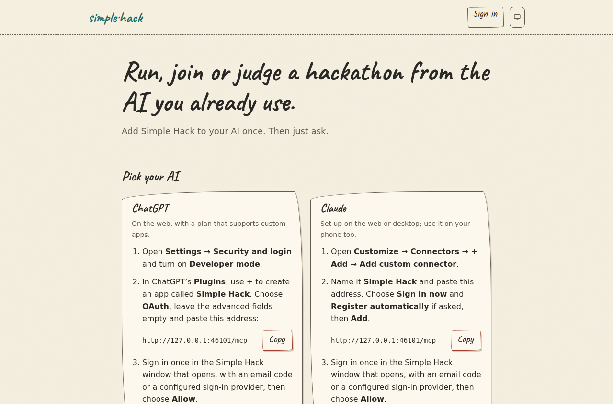

# Install the full Simple Hack platform

[Open ChatGPT Plugins](https://chatgpt.com/plugins). Click **Add**, then choose **Add custom MCP server**. Name it **Simple Hack**, paste `https://<your-domain>/mcp`, and save. In the sign-in window, sign in with an email code or a configured sign-in provider, then choose **Allow**. In a chat, pick Simple Hack from the **+** menu, or just ask. Use your instance’s address.

[Open Claude connectors](https://claude.ai/new?modal=add-custom-connector#customize/connectors/yours). Name it **Simple Hack**, paste `https://<your-domain>/mcp`, and choose **Add**. In the sign-in window, sign in with an email code or a configured sign-in provider, then choose **Allow**. The connector works in the Claude web, desktop, and phone apps.


Simple Hack: **Hackathons, now for everyone.** Participants describe an idea to
their AI and it builds their team's site. No coding needed. The best idea wins,
not the best coder. Organisers choose the platform for college students, product
managers and leaders, and people who aren't programmers.
The full platform uses the same hand-drawn landing film, ink theme, local
Caveat/Kalam fonts and per-event crayon colours as the hosted service. At
`https://<your-domain>/get-started`, “Pick your AI” leads to the instance's own
`https://<your-domain>/mcp`, role prompts and the FAQ; skill folders and plugin
ZIPs are under “Other ways to install” and also name your instance. Use those
instance downloads rather than the hosted GitHub skills when self-hosting.
Organisers share a join link and a private judge link; participants form teams,
publish a team site and complete an entry. No account keys are handed out as
part of that onboarding.




**Release status: v0.8.10 is published.** Its default image and ZIP/tar downloads
are available from the [hack-v0.8.10 release](https://github.com/vineetu/simple-host/releases/tag/hack-v0.8.10).
It adds company sign-in through your own OpenID Connect provider, `EMAIL_SIGNIN=off`,
and the `--tls internal`, `--tls acme`, `--tls certs` and `--ca-cert` options for
running inside a company network (see below). The ZIP and tarball match their
checksums (45 entries), and both images are published for arm64 and amd64. On two
real DigitalOcean droplets: a fresh published-package install with company
certificate files, a company CA and a Dex identity provider records 58 migrations
on a 2 GB droplet; a published v0.8.9 install on a real Let's Encrypt certificate
upgraded to v0.8.10, applied the one new migration, kept its event, member, team
key, team site, settings and credentials, then switched to company sign-in and
`--tls internal`. Checked on 2026-10-16;
[release record](https://github.com/vineetu/simple-host/blob/main/docs/history/simple-hack-release-v0.8.10.md).
v0.8.9 added upload links and partial updates for team sites, the red product icon
and judging-first Manage
([release record](https://github.com/vineetu/simple-host/blob/main/docs/history/simple-hack-release-v0.8.9.md)).
v0.8.8 added storage access presets to team sites and custom event websites
([release record](https://github.com/vineetu/simple-host/blob/main/docs/history/simple-hack-release-v0.8.8.md)).
v0.8.7 added the eight-scene landing film with narration, verified with native
arm64 and emulated amd64 version checks
([release record](https://github.com/vineetu/simple-host/blob/main/docs/history/simple-hack-release-2026-10-10.md)).
Earlier v0.8.6 checks covered event deletion through Settings at 390 and 1280 px
in light and dark, own-domain presentation, and local Coolify Traefik routing,
with 52 migrations.
The earlier v0.8.5 release passed its 42 browser states with 50 migrations.
An actual v0.8.3 package/image upgrade to v0.8.4 retains the database, membership,
entry, team key, team site files, settings and TLS CA. The earlier v0.8.1-to-v0.8.2
upgrade applied six migrations (44 to 50) and retained the same data. The local
checks cover the film, ink theme, event colours, own-domain connector/examples
and local fonts at 320, 390 and 1280 px in light and dark, including a real
take-down state with no broken icon requests. The current Coolify
Compose routing also passed through real local Traefik. The live DigitalOcean installation and private snapshot
tests used
v0.8.0; [those test details](simple-hack-digitalocean.md) distinguish a private
snapshot from Marketplace approval. This package is separate from the older
Simple Host small-box installer.

One installation runs the event platform on your own domain, with its own
accounts, database and site storage. Organisers create events after signing in;
participants form teams, publish team sites, and use the event's judging and
results workflow. Nothing claims a name from simple-host.app.

| Address | What opens there |
|---|---|
| `hack.example.com` | Sign-in, events and management |
| `spring.hack.example.com` | The spring event page |
| `robot.spring.hack.example.com` | The robot team site |

## Before installing

- A Linux server with Docker Engine and the Compose plugin, Python 3, OpenSSL
  and `flock`. Start with 2 GB RAM; site storage is on its persistent disk.
- Your own domain. Point its apex and wildcard A records at the server. Check
  that both `event.<domain>` and `team.event.<domain>` resolve there. Avoid
  conflicting explicit records. Default port bindings use IPv4; remove AAAA
  records unless you also configure and verify IPv6 bindings and routing.
- Public TCP ports 80 and 443 reaching this installation; no other web server
  may already occupy them. [Coolify](simple-hack-coolify.md) uses its existing proxy.
- A Resend API key and a verified sender address. Email-code sign-in requires
  these; setting a fake key does not provide working sign-in. Google sign-in
  is optional and uses your own OAuth application and redirect configuration.

### Certificate capacity

Caddy obtains and renews an individual certificate for each requested event or
team address. No DNS provider API credentials are needed. The application
checks the requested hostname before Caddy obtains a certificate. Keep the
certificate volume during upgrades and restores.

Let's Encrypt currently permits 50 new certificates per registered domain per
seven days, shared with other applications using that registered domain.
Account for the platform, event pages and each team site before a large
event; arrange an appropriate CA rate-limit override before participants join.
This package does not install the production service's Vercel-specific
per-event wildcard issuer. An operator-managed wildcard setup is a separate
deployment requiring a certificate for each `*.<event>.<domain>`; one
`*.<domain>` certificate does not cover team addresses. Do not assume this
package automates that alternative. [CA limits](https://letsencrypt.org/docs/rate-limits/),
[Caddy on-demand TLS](https://caddyserver.com/docs/caddyfile/options).

## Install

Use a checkout or unpacked artifact from the release you intend to install.
From the repository root, create a private configuration file:

```sh
umask 077; cp deploy/hack/standalone/.env.example /tmp/simple-hack.env; ${EDITOR:-vi} /tmp/simple-hack.env
```

Set `SITE_DOMAIN`, `RESEND_API_KEY`, and `MAIL_FROM`. Leave the four secret
fields empty to generate independent values on first install. Set
`SIMPLE_HACK_IMAGE` only if using a different application image.

```sh
sudo bash deploy/hack/standalone/install.sh --config /tmp/simple-hack.env
```

The installer writes `/opt/simple-hack/.env` with mode 0600, creates an isolated
Postgres database, loads the schema and migrations, then starts the app and
Caddy. It does not print secrets. The application image and its bundled schema
must come from the same release. Container readiness is checked locally;
public DNS and trusted HTTPS still need the client checks below.

Open the configured domain, sign in by email, create an event, join it as a
participant and publish a team site. Verify the event and team site addresses
over HTTPS from another machine. `/healthz` and `/readyz` must return 200;
`/internal/tls-ask` must return 404 from the public address.

## Company sign-in and running inside your network

A company installation can let people sign in with their existing work account
instead of an emailed code, and can run entirely inside the company network
instead of on the public internet. The two are independent: set up company
sign-in, a private network, both, or neither.

### Settings

| Setting | What it does |
|---|---|
| `OIDC_ISSUER` | The identity provider's issuer URL. Setting this together with `OIDC_CLIENT_ID` and `OIDC_CLIENT_SECRET` turns on company sign-in. |
| `OIDC_CLIENT_ID` | The OAuth client ID registered at the identity provider. |
| `OIDC_CLIENT_SECRET` | The client secret. Never print or log it. |
| `ALLOWED_EMAIL_DOMAINS` | A comma list, for example `example.com,example.co.uk`. Sign-in from any other email domain is refused. Required when the issuer is Google, since any Google account can otherwise authenticate, not only this company's. |
| `OIDC_LABEL` | The name on the sign-in button. Default text reads "Sign in with your company account"; setting `OIDC_LABEL=Acme Okta` changes it to "Sign in with Acme Okta". |
| `OIDC_INSECURE_ALLOWED` | Set to `true` only to allow a plain HTTP issuer for local testing. Leave unset in any real installation. |
| `EMAIL_SIGNIN` | `on` by default. Set to `off` to turn off email-code sign-in everywhere: the account, the connector and every team site's visitors. The server refuses to start with `EMAIL_SIGNIN=off` unless company sign-in is configured, so there is always a way in. |

With company sign-in configured, `RESEND_API_KEY` and `MAIL_FROM` become
optional: no email is sent (no sign-in codes, no notices) unless they are
also set.

### Registering the redirect URI

Every identity provider needs the same redirect URI, built from your own
domain:

```
https://<SITE_DOMAIN>/v1/auth/oauth/oidc/callback
```

- **Okta.** Admin console, Applications, Create App Integration, choose OIDC
  and Web Application. Set the sign-in redirect URI above and the grant type
  to Authorization Code. `OIDC_ISSUER` is the org URL, for example
  `https://your-org.okta.com`.
- **Google Workspace.** Google Cloud Console, APIs & Services, Credentials,
  Create OAuth client ID, Web application. Set the authorized redirect URI
  above. `OIDC_ISSUER` is `https://accounts.google.com`; set
  `ALLOWED_EMAIL_DOMAINS` to the company's domain so sign-in stays inside the
  organisation.
- **Microsoft Entra ID.** Entra admin center, App registrations, New
  registration, platform Web, with the redirect URI above. `OIDC_ISSUER` is
  `https://login.microsoftonline.com/<tenant-id>/v2.0`. Create the client
  secret under Certificates & secrets.
- **Keycloak.** In the realm, Clients, Create client, OpenID Connect, with
  client authentication on and the valid redirect URI above. `OIDC_ISSUER` is
  `https://<keycloak-host>/realms/<realm>`.

### Choosing a TLS mode

`TLS_MODE` (`--tls` at install time) picks how Caddy gets its certificates.
All four keep the on-demand behaviour of obtaining a certificate the first
time each hostname is requested; only the source of the certificate changes.

| Mode | Source | Use it when |
|---|---|---|
| `public` (default) | Let's Encrypt, the same as today | The server is reachable from the public internet on ports 80 and 443. |
| `internal` | Caddy's own local certificate authority | The server is only reachable inside the company network, with no public DNS and no outbound ACME traffic, and IT can add one more trusted root to company devices. |
| `acme` | The company's own ACME server (`--acme-ca URL`), for example step-ca, Smallstep, Active Directory Certificate Services with its ACME add-on, or Vault PKI's ACME endpoint | The company already runs internal PKI and wants Simple Hack's certificates issued and renewed through it like everything else internal. |
| `certs` | Certificate files you supply (`--cert-dir DIR`), no on-demand issuance | There is a known, fixed list of addresses in advance and no CA (public, internal or ACME) is available or wanted. |

`--ca-cert FILE` supplies the company's root certificate (PEM). It is trusted
by the application for calls to an internal identity provider, and, in `acme`
mode, by Caddy for calls to an internal ACME server; it is copied to
`tls/ca.pem` in the install directory and is unrelated to which `TLS_MODE` is
in effect.

For `certs` mode, each `.pem` file in `--cert-dir` holds a certificate chain
and its private key together. Across all the files, the coverage must include
the apex domain, its wildcard, and the wildcard of every event:
`<domain>`, `*.<domain>` and `*.<event>.<domain>` for each event you run.
A single wildcard certificate covering `<domain>` and `*.<domain>` is not
enough on its own, because a team site is a third DNS label down
(`<team>.<event>.<domain>`); add one certificate per event, or reissue the
event wildcard whenever a new event is created.

### DNS inside the company

A private installation needs the same two DNS shapes as a public one, just
answered by the company's internal DNS instead of a public registrar: an
apex record for the domain itself and a wildcard record for everything under
it (`hack.company.internal` and `*.hack.company.internal`). That one wildcard
resolves both an event address (`spring.hack.company.internal`) and a team
address under it (`robot.spring.hack.company.internal`). Point both records
at the server's address on the company network, and keep them off any public
DNS zone.

### Trusting the certificate on company devices

In `internal` mode, no public certificate authority is involved, so devices
need to trust Caddy's own root certificate once. After the first HTTPS
request to the installation (an issuance only happens on demand), the
installer prints a one-line command that saves that root certificate to a
file; hand that file to IT to add to the trusted roots on company devices
through whatever they normally use (MDM, group policy, or similar). The
`acme` mode's trust question is handled the same way as the rest of the
company's internal PKI, since the certificates come from there.

## Upgrade and persistence

Back up both named volumes: `db` holds Postgres; `data` holds team site files,
certificates and access logs. Use a logical Postgres backup plus the data
volume, or stop the installation while taking a consistent volume snapshot.
Deleting the Compose volumes deletes the installation's data.

From the new release's checkout, run its upgrade script with that release's
published image:

```sh
sudo bash deploy/hack/standalone/upgrade.sh --image ghcr.io/vineetu/simple-hack:0.8.10
```

Upgrades retain the domain, credentials, database and files. The previous environment file is kept
as `.env.previous`. The installer stops the app while applying migrations;
if migration fails, it leaves the app stopped and both volumes intact. Fix the
cause and rerun. Do not downgrade a migrated database without checking schema
compatibility or restoring a matching backup.

All four `MCP_APP_*` flags are passed to the container, default off, and kept in
`.env` across reruns. Supply them through `--config`, or export them for the
first install. Hack's product gates still apply; these flags alone do not offer
Host screens to organisers or teams. The Coolify and DigitalOcean packages
carry the same settings.

After upgrading to a release with `zi-site-search-summary.sql`, populate old
site summaries after migration with this idempotent command:

```sh
docker compose --project-directory /opt/simple-hack --env-file /opt/simple-hack/.env run --rm --no-deps -T app site-summary-backfill
```

For additional application settings, add environment entries under both
`release` and `app` as needed in your copy of `compose.yaml`; consult
[configuration.md](../configuration.md). The bundled defaults enable the full
event platform, with 30-day archived-site retention and a warning 14 days
before removal. The site byte budget and retention values are environment
settings, not limits on event attendance.

## Build and local verification

The `hack-v0.8.10` release builds a matching base image and platform image from
one checkout and provides a ZIP or tar.gz installation package. It leaves the
older Simple Host small-box release pins intact. For a local build after that
base image exists, use the same release checkout:

```sh
docker build --build-arg SIMPLE_HOST_IMAGE=ghcr.io/vineetu/simple-host:hack-0.8.10 -f deploy/hack/standalone/Dockerfile -t simple-hack:candidate .
```

For an unpublished build, replace `SIMPLE_HOST_IMAGE` with a locally built
image containing its static binary at `/usr/local/bin/simple-host`. The schema
is copied from this checkout. Release publication must build both artifacts
from the same commit and publish the standalone image for each supported CPU.

```sh
bash deploy/hack/standalone/tests/install_test.sh
```

```sh
TEST_IMAGE=simple-hack:candidate bash deploy/hack/standalone/tests/smoke.sh
```

The smoke test uses disposable containers, loopback ports 18474–18476, a local
CA and admin-created fixture accounts. It checks fresh installation, a real
event and published team site, restart and upgrade persistence. It does not
claim production ACME issuance, browser email delivery or a cloud deployment.
Set `TEST_COOLIFY_PROXY=1` to also exercise the raw Coolify routing through a
real local Traefik container (Python's PyYAML is required). That test retains
the same event and site while replacing the direct port mapping with TLS
passthrough, checks hostname certificate refusal, visitor IP handling and
API-key log filtering, then removes its containers, network and volumes.

To test a real previous-to-current release upgrade locally, set
`TEST_PREVIOUS_IMAGE` to the previous published image and `TEST_IMAGE` to the
current image when running `tests/smoke.sh`. Set `TEST_PREVIOUS_PACKAGE` to
the previous download’s `deploy/hack/standalone` directory to use its installer
for the initial installation. `TEST_HACK_PRESENTATION=1` also
checks the film, local fonts, shared navigation and instance-specific
connector, API and skills. The fixture verifies the entry, team credential,
event settings, deployed files and local TLS CA after upgrading.
